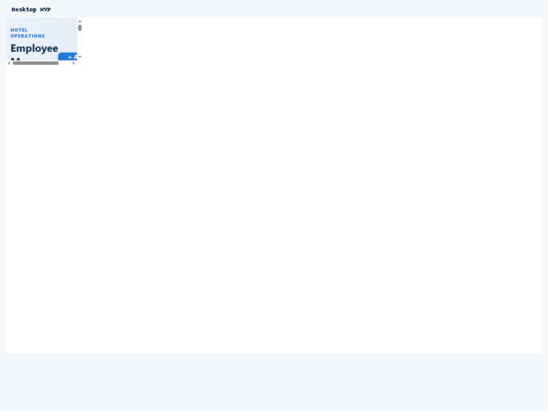

# TestingApp

Spring Boot API for employee management, backed by PostgreSQL.

## MVP en funcionamiento

La aplicación incluye un frontend Angular responsive conectado a la API y PostgreSQL.

### Demostración



### Vista de escritorio


### Creación de empleados


### Vista móvil


## Run with Docker

```powershell
docker compose up --build
```

The API is available at `http://localhost:8080`. PostgreSQL is available at `localhost:5432`.
The responsive Angular frontend is available at `http://localhost:4201`.

Default local database credentials:

- Database: `postgres`
- User: `postgres`
- Password: `postgres`

Stop the stack:

```powershell
docker compose down
```

To also remove the database volume:

```powershell
docker compose down --volumes
```

## API

- `GET /` - health check
- `GET /employees/{id}`
- `POST /employees`
- `PUT /employees/{id}`
- `DELETE /employees/{id}`

Example request:

```json
{
  "email": "user@example.com",
  "name": "Example User",
  "salary": 50000
}
```

## Tests

### Backend Tests (Spring Boot & JUnit)

```powershell
.\mvnw.cmd test
```

### Frontend Tests (Angular 19 & Karma)

```powershell
npm run test:ci --prefix frontend
```
